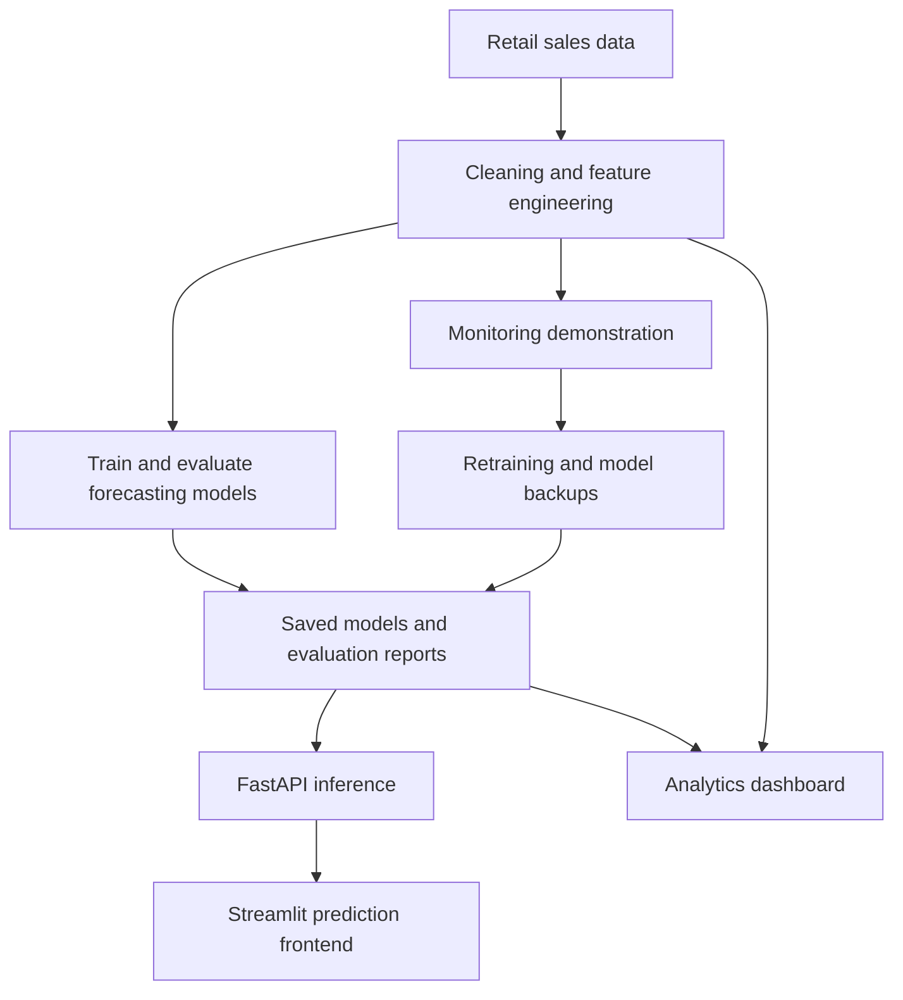
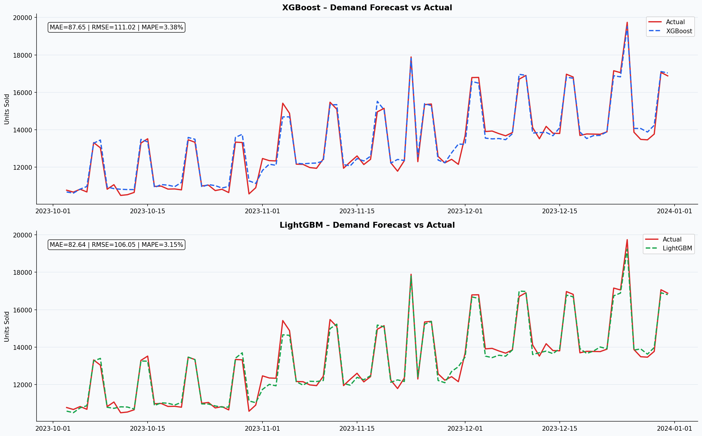
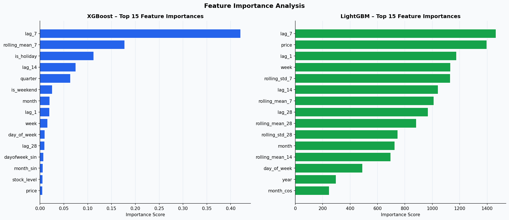

# Demand Forecasting & Inventory Optimization Engine

**DEPI Graduation Project — AI & Data Science / Microsoft Machine Learning Engineer**

A retail analytics project that combines demand forecasting, inventory decision support, interactive dashboards, and an MLOps demonstration workflow.

The project explores statistical, machine learning, and deep learning approaches to sales forecasting, with **LightGBM** selected as the primary model in the saved evaluation reports.

## Project Overview

Retail inventory planning requires balancing product availability against excess stock. This project uses historical sales, calendar patterns, pricing, promotions, and stock information to estimate demand and generate rule-based replenishment recommendations.

The repository covers the workflow from raw data preparation to model evaluation, API serving, dashboard visualization, and deployment configuration.

## Key Features

- **Data preparation:** missing-value handling, IQR-based outlier capping, categorical encoding, and schema checks.
- **Feature engineering:** calendar features, cyclical encodings, historical lags, rolling statistics, and stock-related indicators.
- **Model comparison:** SARIMA, XGBoost, LightGBM, and LSTM.
- **Prediction API:** single and batch predictions, multi-day forecasts, model metadata, and saved metrics.
- **Inventory decision support:** stock coverage classification, reorder points, and suggested order quantities.
- **Interactive interfaces:** a Streamlit analytics dashboard and a separate API-connected prediction frontend.
- **Deployment assets:** a Dockerfile, Azure Bicep infrastructure, and an Azure deployment script.
- **MLOps demonstration:** KS/PSI drift checks, performance alerts, retraining, model backups, and version history.

## Workflow



## Dataset and Features

The saved [preprocessing report](reports/preprocessing_report.json) records:

| Item | Recorded value |
|---|---:|
| Raw records | 730,500 |
| Raw columns | 11 |
| Processed columns | 38 |
| Features used by the tree models | 27 |

The raw dataset is stored at `data/raw/retail_sales.csv`.

Its columns include `date`, `store_id`, `store_type`, `product_id`, `category`, `units_sold`, `price`, `is_promotion`, `is_holiday`, `stock_level`, and `revenue`.

The project works with five product categories: **Electronics, Clothing, Food, Home, and Sports**.

### Engineered Features

| Feature group | Examples |
|---|---|
| Calendar | Year, month, week, quarter, day of week, weekend flag |
| Cyclical encoding | Sine/cosine representations of month and day of week |
| Historical demand | Lags of 1, 7, 14, and 28 observations per store-product series |
| Rolling statistics | Historical means and standard deviations over 7, 14, and 28 observations |
| Commercial context | Price, promotion flag, holiday flag, price-discount indicator |
| Inventory context | Stock level and stockout indicator |
| Categorical inputs | Encoded store type and product category |

The processed CSV is not committed directly; the repository includes a reference in [processed_data_link.txt](data/processed/processed_data_link.txt). It can also be regenerated with the preprocessing script.

## Forecasting Models

| Model | Approach | Training target |
|---|---|---|
| SARIMA | SARIMA(1,1,1)(1,1,1,7), with weekly seasonality | Total daily units across all stores and products |
| XGBoost | Gradient-boosted regression trees | Daily category-level units |
| LightGBM | Gradient-boosted regression trees | Daily category-level units |
| LSTM | Three LSTM layers with 128, 64, and 32 units; 30-day lookback | Total daily units across all stores and products |

### Saved Evaluation Results

The initial [evaluation report](reports/evaluation_report.txt) records a final 90-day evaluation window.

| Model | MAE ↓ | RMSE ↓ | MAPE ↓ |
|---|---:|---:|---:|
| SARIMA | 1,875.64 | 2,449.89 | 12.96% |
| XGBoost | 87.65 | 111.02 | 3.38% |
| **LightGBM** | **82.64** | **106.05** | **3.15%** |
| LSTM | 633.80 | 1,012.11 | 4.65% |

**Interpretation:** the tree models predict category-level totals, while SARIMA and LSTM predict overall daily totals. Their MAE and RMSE therefore use different target scales. These results summarize the repository's experiments rather than a controlled comparison on identical targets.

MAPE is a percentage error metric; it should not be interpreted as classification accuracy.

### Retrained Model Results

The later [evaluation summary](models/evaluation_summary.json), recorded on **June 29, 2026**, contains:

| Model | MAE ↓ | RMSE ↓ | MAPE ↓ |
|---|---:|---:|---:|
| **LightGBM** | **82.86** | **106.10** | **3.16%** |
| XGBoost | 85.59 | 110.15 | 3.29% |

These are separate from the initial experiment results. The saved summary selects LightGBM as the best model.

### Project Visualizations





More plots covering seasonality, promotions, sales distributions, store performance, and model evaluation are available in [reports](reports/).

## Technology Stack

| Area | Tools |
|---|---|
| Language and data | Python, pandas, NumPy, SciPy |
| Machine learning | scikit-learn, XGBoost, LightGBM |
| Statistical forecasting | statsmodels |
| Deep learning | TensorFlow / Keras |
| API | FastAPI, Pydantic, Uvicorn |
| Dashboard and charts | Streamlit, Plotly, Matplotlib, Seaborn |
| Model persistence | joblib, Keras model files |
| Deployment | Docker, Azure CLI, Bicep |
| Scheduling and monitoring | schedule, KS test, Population Stability Index |

## Repository Structure

| Path | Purpose |
|---|---|
| `data/raw/` | Raw retail sales dataset |
| `data/processed/` | Processed-data reference and generated CSV location |
| `src/data_prep/` | Preprocessing and exploratory analysis |
| `src/models/` | Training scripts and evaluation report generation |
| `src/api/` | FastAPI service, API-connected frontend, and API test script |
| `src/dashboard/` | Analytics and MLOps dashboard |
| `src/monitoring/` | Drift detection, performance checks, and scheduler |
| `src/retraining/` | Model retraining and versioning |
| `models/` | Saved model artifacts, scaler, and metrics |
| `reports/` | Plots, preprocessing report, and evaluation report |
| `mlops/` | Monitoring outputs, retraining history, and model backups |
| `deployment/docker/` | API Dockerfile |
| `deployment/azure/` | Azure infrastructure and deployment script |

## Getting Started

Use **Python 3.11**, matching the Docker base image. Run the following commands from the repository root unless stated otherwise.

### 1. Clone and Create an Environment

```bash
git clone https://github.com/Abdallah317/Deman-Foercasting-Inventory-Optimization-Engine.git
cd Deman-Foercasting-Inventory-Optimization-Engine
python -m venv .venv
```

Activate the environment:

**Windows PowerShell**

```powershell
.\.venv\Scripts\Activate.ps1
```

**Linux / macOS**

```bash
source .venv/bin/activate
```

### 2. Install Dependencies

```bash
python -m pip install --upgrade pip
python -m pip install -r requirements.txt
```

The committed requirements cover the API and core tree models. The dashboard, analysis, and scheduling modules require additional packages:

```bash
python -m pip install streamlit plotly matplotlib seaborn scipy statsmodels schedule requests
```

For LSTM training, also install TensorFlow:

```bash
python -m pip install "tensorflow==2.16.1"
```

### 3. Start the API

The repository includes saved LightGBM and XGBoost models, so API inference does not require retraining first.

```bash
python -m uvicorn src.api.main:app --host 127.0.0.1 --port 8000 --reload
```

- Interactive API documentation: [http://127.0.0.1:8000/docs](http://127.0.0.1:8000/docs)
- Health endpoint: [http://127.0.0.1:8000/health](http://127.0.0.1:8000/health)

Check that the health response lists `lightgbm` and `xgboost` under `models_loaded`; the health endpoint can respond even if model loading failed.

### 4. Start the Prediction Frontend

In a second terminal, activate the same environment and run:

```bash
python -m streamlit run src/api/app_frontend.py
```

This frontend connects to the API at `http://127.0.0.1:8000`.

### 5. Prepare Data and Open the Analytics Dashboard

```bash
python src/data_prep/preprocess.py
python -m streamlit run src/dashboard/dashboard.py
```

The analytics dashboard provides **Overview**, **Demand Forecast**, **Inventory**, **EDA Explorer**, and **MLOps Monitor** pages.

## API Reference

| Method | Endpoint | Purpose |
|---|---|---|
| GET | `/` | Service information |
| GET | `/health` | Service status and loaded model entries |
| POST | `/predict` | Single prediction and inventory status |
| POST | `/predict/batch` | Up to 100 prediction requests |
| GET | `/forecast/{days}` | Recursive LightGBM forecast, from 1 to 365 days |
| GET | `/inventory/recommend` | Demonstration inventory recommendations |
| GET | `/models/info` | Model metadata and input feature list |
| GET | `/metrics` | Saved evaluation summary |

### Prediction Example

Submit this JSON through `POST /predict` in Swagger UI:

```json
{
  "date": "2024-01-15",
  "store_id": 1,
  "product_id": 5,
  "category": "Electronics",
  "store_type": "Urban",
  "price": 149.99,
  "stock_level": 50,
  "is_promotion": 0,
  "is_holiday": 0,
  "lag_1": 20,
  "lag_7": 18,
  "lag_14": 19,
  "lag_28": 17,
  "rolling_mean_7": 19.5,
  "rolling_mean_14": 18.8,
  "rolling_mean_28": 18.2,
  "rolling_std_7": 3.2,
  "rolling_std_28": 3.5,
  "model": "lightgbm"
}
```

Use `"model": "xgboost"` to select the secondary model. The numeric values above demonstrate the request schema; operational inputs must be prepared at the same aggregation level and with the same encoding as the trained model.

## Reproduce the Training Workflow

Prepare the processed data, then run the model scripts:

```bash
python src/data_prep/preprocess.py
python src/data_prep/eda_analysis.py
python src/models/model_sarima.py
python src/models/model_ml.py
python src/models/model_lstm.py
```

These scripts generate or replace model artifacts, metrics, and plots.

The comparison script is `src/models/evaluation_report.py`. Its final write currently uses the hard-coded path `Demand_Forecasting_Engine/reports/evaluation_report.txt`; align that path with the existing `REPORT_DIR` before rerunning it.

## Inventory Decision Logic

The API calculates stock coverage from available stock and predicted daily demand.

| Days of coverage | Status |
|---|---|
| Less than 3 | CRITICAL |
| 3 to less than 7 | LOW |
| 7 to less than 14 | ADEQUATE |
| 14 or more | EXCESS |

For single predictions, a reorder is recommended when stock is below three days of predicted demand.

The inventory recommendation endpoint also calculates a reorder point from daily demand and configurable safety-stock days. This is rule-based decision support; the repository does not implement a cost-minimizing inventory optimization solver.

## MLOps Workflow

Monitoring includes:

- Kolmogorov–Smirnov drift checks with a p-value threshold of **0.05**.
- Population Stability Index checks with a threshold of **0.2**.
- Performance checks against saved baseline metrics.
- Retraining recommendations and JSON reports.

Run the monitoring demonstration:

```bash
python src/monitoring/monitor.py
```

Run forced retraining:

```bash
python src/retraining/retrain.py
```

Retraining backs up the previous tree models, replaces the active model files, updates the evaluation summary, and appends a version-history entry. Restart the API after retraining to load the new models.

The scheduler runs a one-off demonstration by default:

```bash
python src/monitoring/scheduler.py
```

For continuous scheduling, change its entry point to `start_scheduler(run_once=False)`. Configured jobs run daily at **06:00** for monitoring and on Mondays at **02:00** for retraining, using the host's local timezone. Retraining can be skipped when the monitoring report does not recommend it.

## Deployment

### Docker

Build from the repository root:

```bash
docker build -f deployment/docker/Dockerfile -t demand-forecasting-api .
docker run --rm -p 8000:8000 demand-forecasting-api
```

The image serves the FastAPI application. Streamlit interfaces run separately.

### Azure

Deployment assets are available in:

- [azure_deploy.bicep](deployment/azure/azure_deploy.bicep)
- [deploy_azure.sh](deployment/azure/deploy_azure.sh)

The script requires Azure CLI authentication and a running Docker installation. Review the resource group, region, environment, image settings, and infrastructure template before deployment. The repository includes deployment configuration; this README does not assert that a public deployment is currently active.

## Current Implementation Notes

- **Forecasting granularity:** the tree models are trained on daily category aggregates. Store and product identifiers in the API do not establish validated store-product forecasting capability.
- **Inference alignment:** preprocessing uses pandas categorical codes, while the API defines manual category mappings. Align these mappings and all feature definitions before relying on operational predictions.
- **Historical inputs:** omitted lag and rolling features use fixed defaults. The frontend supplies example history, and the multi-day forecast starts from a default lag buffer with a preset promotion schedule.
- **Prediction ranges:** the API returns a fixed ±15% range labeled as a confidence interval. It is a heuristic range without demonstrated statistical coverage.
- **Inventory demonstration:** the recommendation endpoint generates sample stock and price values rather than reading a live inventory system.
- **Monitoring demonstration:** the default monitoring run uses simulated predictions and generated baseline samples. Live monitoring requires actual prediction logs, observed outcomes, and representative reference data.
- **Evaluation:** saved metrics document project experiments. A stricter benchmark should align target granularity, fit preprocessing only on training data, and reserve an untouched test window.

## Project Context

Developed as a team graduation project for the **Digital Egypt Pioneers Initiative (DEPI)**, under the **AI & Data Science — Microsoft Machine Learning Engineer** track.


